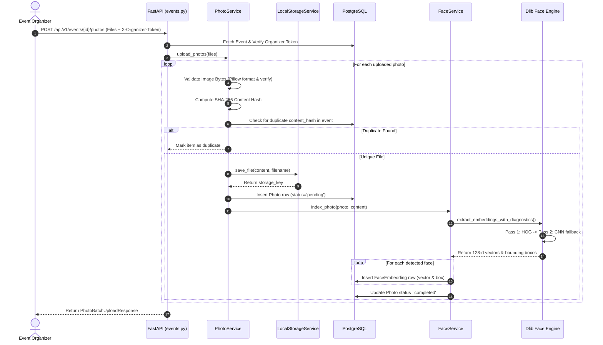
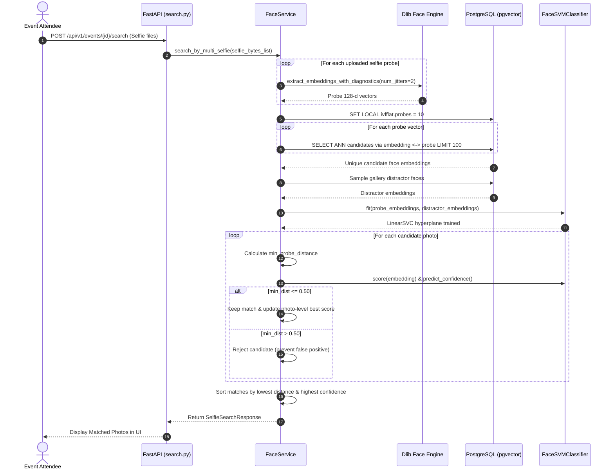

# AI Event Photo Finder — Backend Architecture & Technical Reference

This document provides a comprehensive technical breakdown of the entire backend system of **AI Event Photo Finder** (`backend/app`). It explains every module, file, class, method, data flow, and underlying AI/database integration in detail.

---

## 1. System Overview & Technology Stack

The backend is built as a high-performance, asynchronous REST API designed to ingest thousands of event photographs, detect and index human faces into high-dimensional vector space, and allow attendees to retrieve all photos containing their face via single or multi-angle selfie probes (supporting frontal, angled, and side profiles).

```
                      +-----------------------------+
                      |       Client / Frontend     |
                      +--------------+--------------+
                                     | HTTP / REST
                                     v
                      +-----------------------------+
                      |     FastAPI Application     |
                      |        (app/main.py)        |
                      +--------------+--------------+
                                     |
              +----------------------+----------------------+
              |                      |                      |
              v                      v                      v
     +-----------------+    +-----------------+    +-----------------+
     |  Events Router  |    |  Photos Router  |    |  Search Router  |
     | (api/v1/events) |    | (api/v1/photos) |    | (api/v1/search) |
     +--------+--------+    +--------+--------+    +--------+--------+
              |                      |                      |
              +----------------------+----------------------+
                                     |
                                     v
                      +-----------------------------+
                      |        Service Layer        |
                      |  - EventService             |
                      |  - PhotoService             |
                      |  - FaceService              |
                      +-------+--------------+------+
                              |              |
             +----------------+              +----------------+
             v                                                v
+---------------------------+                    +---------------------------+
|    AI & Facial Pipeline   |                    |   Storage & Persistence   |
|  - DlibFaceRecognition    |                    |  - LocalStorageService    |
|  - FaceSVMClassifier      |                    |  - PostgreSQL 16 +        |
|  - Diagnostic Tracing     |                    |    pgvector (IVFFlat ANN) |
+---------------------------+                    +---------------------------+
```

### Core Technologies
- **Language & Runtime:** Python 3.11+ / 3.13 (AsyncIO)
- **Web Framework:** [FastAPI](https://fastapi.tiangolo.com/) with asynchronous request handlers and Pydantic v2 validation.
- **Relational & Vector Database:** PostgreSQL 16 paired with [`pgvector`](https://github.com/pgvector/pgvector) for sub-linear Approximate Nearest Neighbor (ANN) index searches over 128-dimensional biometric embeddings.
- **ORM & Migrations:** [SQLAlchemy 2.0](https://www.sqlalchemy.org/) (Async Engine via `asyncpg`, sync fallback via `psycopg2` for Alembic migrations).
- **Computer Vision & Face Embeddings:** `dlib` / `face_recognition` (ResNet-34 128-dimensional Euclidean metric embeddings with two-pass HOG and MMOD CNN detection).
- **Adaptive Machine Learning Reranking:** `scikit-learn` `LinearSVC` (personalized Support Vector Machine dynamically trained at query-time to isolate the attendee from event distractors).
- **Image Processing & Integrity Validation:** Pillow (`PIL.Image`) for byte-level integrity verification, format whitelisting, and geometry inspection.

---

## 2. Directory Structure

```
backend/
├── alembic/                         # Database schema migrations
│   ├── env.py                       # Alembic migration runner
│   └── versions/                    # Versioned migration scripts
├── app/
│   ├── ai/                          # AI / Facial Recognition sub-framework
│   │   ├── base.py                  # Abstract FaceRecognitionService interface
│   │   ├── diagnostics.py           # Pipeline instrumentation, traces & failure modes
│   │   ├── face_recognition_service.py # Dlib HOG/CNN ResNet-34 embedding provider
│   │   ├── svm_classifier.py        # Runtime personalized Linear SVM classifier
│   │   └── __init__.py              # AI singleton factory and exports
│   ├── api/
│   │   └── v1/                      # Version 1 REST API routers
│   │       ├── events.py            # Event management & ingestion endpoints
│   │       ├── health.py            # Service health and database probe endpoint
│   │       ├── photos.py            # Photo retrieval, download, and deletion
│   │       ├── search.py            # Attendee multi-angle selfie search endpoint
│   │       └── __init__.py          # API v1 router aggregator
│   ├── core/
│   │   ├── config.py                # Environment configuration (Pydantic BaseSettings)
│   │   └── database.py              # Async SQLAlchemy engine & session factory
│   ├── models/                      # SQLAlchemy ORM database models
│   │   ├── base.py                  # DeclarativeBase and TimestampMixin
│   │   ├── event.py                 # Event model definition
│   │   ├── face_embedding.py        # FaceEmbedding model with pgvector 128-d vector
│   │   ├── photo.py                 # Photo model definition
│   │   └── __init__.py              # Model exports
│   ├── schemas/                     # Pydantic validation and serialization schemas
│   │   ├── event.py                 # Event request/response schemas
│   │   ├── face.py                  # Face search request/response schemas
│   │   ├── health.py                # Health response schema
│   │   └── photo.py                 # Photo request/response schemas
│   ├── services/                    # Domain business logic layer
│   │   ├── event_service.py         # Event operations, slug generation, statistics
│   │   ├── face_service.py          # Face indexing, pgvector ANN query, SVM scoring
│   │   ├── photo_service.py         # Batch image validation, storage, deduplication
│   │   └── __init__.py              # Service exports
│   ├── storage/                     # File asset storage abstraction
│   │   ├── base.py                  # Abstract StorageService interface
│   │   ├── local.py                 # Local filesystem storage implementation
│   │   └── __init__.py              # Storage singleton provider
│   └── main.py                      # Application entrypoint & FastAPI factory
├── Dockerfile                       # Multi-stage production container build
├── requirements.txt                 # Python dependencies
└── tests/                           # Pytest asynchronous test suite
```

---

## 3. Core Layer (`app/core`)

### 3.1 `app/core/config.py` (`Settings`)
Central configuration management driven by Pydantic's `BaseSettings`. Loads variables from `.env` and environment variables.

- **Key Settings Attributes:**
  - `PROJECT_NAME`: Identifier name (`AI Event Photo Finder`).
  - `VERSION`: API version string (`0.1.0`).
  - `API_V1_STR`: API route prefix (`/api/v1`).
  - `POSTGRES_SERVER`, `POSTGRES_PORT`, `POSTGRES_USER`, `POSTGRES_PASSWORD`, `POSTGRES_DB`: PostgreSQL connection attributes.
  - `DATABASE_URL`: Optional direct override string.
  - `STORAGE_DIR`: Local disk directory for file persistence (defaults to `storage_data`).
  - `MAX_UPLOAD_SIZE_BYTES`: Hard ceiling on single photo uploads (`15 MB`).
  - `ALLOWED_IMAGE_TYPES`: MIME whitelist (`image/jpeg`, `image/png`, `image/webp`, etc.).
  - `BACKEND_CORS_ORIGINS`: Allowed browser origins (`http://localhost:3000`, etc.).
- **Computed Properties:**
  - `sync_database_url`: Formats a synchronous connection string using `postgresql+psycopg2://` (used by Alembic migration worker).
  - `async_database_url`: Formats an asynchronous connection string using `postgresql+asyncpg://` (used by FastAPI async engine).

### 3.2 `app/core/database.py` (Database Engine & Session Management)
Configures asynchronous connection pooling to PostgreSQL.

- **`async_engine`**: Created via `create_async_engine(settings.async_database_url)`.
  - Configures `pool_size=10`, `max_overflow=20`, and `pool_pre_ping=True` (or `NullPool` during testing to prevent lingering SQLite connections).
- **`AsyncSessionLocal`**: `async_sessionmaker` bound to `async_engine` with `expire_on_commit=False` and `autoflush=False`.
- **`get_db()`**: Asynchronous generator dependency injected into FastAPI route endpoints. Yields an `AsyncSession` and guarantees session cleanup in a `finally` block:
  ```python
  async def get_db() -> AsyncGenerator[AsyncSession, None]:
      async with AsyncSessionLocal() as session:
          try:
              yield session
          finally:
              await session.close()
  ```
- **`check_database_connection()`**: Executes `SELECT 1` wrapped in an explicit `asyncio.wait_for(..., timeout=2.0)`. Used by the healthcheck endpoint to confirm database liveness without blocking or hanging on network failure.

---

## 4. Database Models (`app/models`)

The database architecture employs PostgreSQL 16 with the `pgvector` extension.

```
       +---------------------------------------------+
       |                   events                    |
       +---------------------------------------------+
       | id (UUID, PK)                               |
       | name (VARCHAR 255)                          |
       | slug (VARCHAR 100, UNIQUE, INDEX)           |
       | status (VARCHAR 50)                         |
       | organizer_token (VARCHAR 128, INDEX)        |
       | event_date (DATE)                           |
       | description (TEXT)                          |
       | created_at, updated_at (TIMESTAMPTZ)        |
       +----------------------+----------------------+
                              | 1
                              |
                              | * (CASCADE DELETE)
                              v
       +---------------------------------------------+
       |                   photos                    |
       +---------------------------------------------+
       | id (UUID, PK)                               |
       | event_id (UUID, FK -> events.id, INDEX)     |
       | original_filename (VARCHAR 255)             |
       | storage_key (VARCHAR 512, UNIQUE)           |
       | content_type (VARCHAR 100)                  |
       | file_size (BIGINT)                          |
       | image_width, image_height (INTEGER)         |
       | content_hash (VARCHAR 64, SHA-256)          |
       | processing_status (VARCHAR 50, INDEX)       |
       | processing_error (TEXT)                     |
       | created_at, processed_at (TIMESTAMPTZ)      |
       +----------------------+----------------------+
       | UNIQUE(event_id, content_hash)              |
       | INDEX(event_id, processing_status)          |
       +----------------------+----------------------+
                              | 1
                              |
                              | * (CASCADE DELETE)
                              v
       +---------------------------------------------+
       |               face_embeddings               |
       +---------------------------------------------+
       | id (UUID, PK)                               |
       | photo_id (UUID, FK -> photos.id, INDEX)     |
       | event_id (UUID, FK -> events.id, INDEX)     |
       | embedding (VECTOR(128))                     |
       | face_top, face_right, face_bottom, face_left|
       | created_at (TIMESTAMPTZ)                    |
       +---------------------------------------------+
       | INDEX ivfflat ON (embedding vector_l2_ops)  |
       +---------------------------------------------+
```

### 4.1 `app/models/base.py`
- **`Base`**: Subclasses SQLAlchemy's `DeclarativeBase`.
- **`TimestampMixin`**: Reusable mixin providing automatic timezone-aware `created_at` and `updated_at` datetime columns initialized to UTC.

### 4.2 `app/models/event.py` (`Event`)
Represents an event created by a photographer or organizer.
- **Fields:**
  - `id`: UUID primary key.
  - `name`: Human-readable name.
  - `slug`: Unique, URL-safe slug used for attendee lookup (e.g. `wedding-reception-a1b2c3d4`).
  - `status`: Lifecycle status (`active`, `archived`).
  - `organizer_token`: High-entropy URL-safe secret token (`secrets.token_urlsafe(32)`) required for administrative operations (uploading photos, deleting photos, re-indexing).
- **Relationships:**
  - `photos`: One-to-many relationship with `Photo` with `cascade="all, delete-orphan"`.
  - `face_embeddings`: One-to-many relationship with `FaceEmbedding` with `cascade="all, delete-orphan"`.

### 4.3 `app/models/photo.py` (`Photo`)
Represents a physical photograph uploaded to an event.
- **Fields:**
  - `id`: UUID primary key.
  - `event_id`: Foreign key referencing `events.id` (ON DELETE CASCADE).
  - `original_filename`: User's original uploaded file name.
  - `storage_key`: Relative path on disk (e.g. `events/{event_id}/{uuid}.jpg`).
  - `content_type`: Verified MIME type (e.g. `image/jpeg`).
  - `file_size`: Size in bytes.
  - `image_width`, `image_height`: Verified pixel dimensions.
  - `content_hash`: Hexadecimal SHA-256 digest of the image bytes.
  - `processing_status`: State tracker (`pending`, `completed`, `failed`).
  - `processing_error`: Descriptive error trace if processing failed.
- **Constraints & Indexes:**
  - `UniqueConstraint("event_id", "content_hash", name="uq_event_photo_content_hash")`: Prevents identical photos from being ingested twice into the same event.
  - `Index("ix_photos_event_status", "event_id", "processing_status")`: Fast filtering for gallery stats and batch operations.

### 4.4 `app/models/face_embedding.py` (`FaceEmbedding`)
Stores one 128-dimensional biometric embedding per detected human face in a photo.
- **Fields:**
  - `id`: UUID primary key.
  - `photo_id`: Foreign key referencing `photos.id` (ON DELETE CASCADE).
  - `event_id`: Foreign key referencing `events.id` (ON DELETE CASCADE). Allows event-scoped vector queries without joining the `photos` table.
  - `embedding`: 128-dimensional vector (`pgvector.sqlalchemy.Vector(128)`).
  - `face_top`, `face_right`, `face_bottom`, `face_left`: Pixel coordinates of the face bounding box.
- **Index:** Indexed in PostgreSQL using an `IVFFlat` index with L2 distance operators (`vector_l2_ops`) for fast approximate nearest neighbor search.

---

## 5. Storage Layer (`app/storage`)

### 5.1 `app/storage/base.py` (`StorageService`)
Defines the abstract interface for asset storage:
- `save_file(content: bytes, filename: str, subfolder: str = "") -> str`
- `get_file_path(storage_key: str) -> Path`
- `delete_file(storage_key: str) -> bool`
- `file_exists(storage_key: str) -> bool`

### 5.2 `app/storage/local.py` (`LocalStorageService`)
Concrete implementation for local filesystem storage.
- **Path Traversal Security (`_resolve_safe_path`):**
  Normalizes path separators and checks `target_path.relative_to(self.base_dir)`. If any path attempts to escape `storage_data/` via `../` sequences, a `ValueError` is raised and logged.
- **Collision-Resistant Filenames (`save_file`):**
  Generates a random UUID filename (e.g. `bc6c6a463fd143a28b3edb757b35b1b1.jpg`) and places it under `storage_data/events/{event_id}/`.
- **`get_file_path`**: Returns a resolved `Path` object after validating that the physical file exists on disk.
- **`delete_file`**: Safely removes the file from disk if present.

---

## 6. Service Layer (`app/services`)

The service layer contains all business workflows.

```
       +--------------------------------------------------------+
       |                      Service Layer                     |
       +--------------------------------------------------------+
            |                        |                       |
            v                        v                       v
   +-----------------+      +-----------------+     +-----------------+
   |  EventService   |      |  PhotoService   |     |   FaceService   |
   +-----------------+      +-----------------+     +-----------------+
   | generate_slug() |      | validate_img()  |     | index_photo()   |
   | create_event()  |      | upload_photos() |     | search_multi()  |
   | verify_token()  |      | list_photos()   |     | reindex_event() |
   | get_stats()     |      | reindex_event() |     | count_faces()   |
   +-----------------+      +-----------------+     +-----------------+
```

### 6.1 `app/services/event_service.py` (`EventService`)
Encapsulates event management and administrative authentication.

- **`generate_slug(name: str) -> str`**:
  Cleans the raw event title using regex `[^a-zA-Z0-9]+` and appends an 8-character hex entropy suffix (`secrets.token_hex(4)`). Guarantees readability while eliminating collision risks.
  *Example:* `"Tech Summit 2026"` $\rightarrow$ `"tech-summit-2026-e4a1b89c"`.
- **`create_event(db: AsyncSession, data: EventCreate) -> Event`**:
  Generates the slug, creates an organizer token via `secrets.token_urlsafe(32)`, instantiates the `Event` record, commits to PostgreSQL, and returns the refreshed entity.
- **`get_event_by_id(db, event_id)` & `get_event_by_slug(db, slug)`**:
  Executes asynchronous `select(Event).where(...)` lookups.
- **`list_events(db, limit, offset)`**:
  Returns a paginated list of events ordered by creation date descending.
- **`verify_organizer_token(event: Event, token: Optional[str]) -> bool`**:
  Uses `hmac.compare_digest(event.organizer_token, token)` to perform constant-time string comparison, protecting organizer endpoints against timing attacks.
- **`get_event_stats(db, event: Event) -> EventStatsResponse`**:
  Executes an aggregated `group_by(Photo.processing_status)` query to compute counts for `total_photos`, `processed_photos`, `pending_photos`, and `failed_photos`, plus total face embeddings via `FaceService.count_detected_faces`.

---

### 6.2 `app/services/photo_service.py` (`PhotoService`)
Handles photograph intake, validation, storage persistence, and deduplication.

- **`validate_image_data(content: bytes) -> Tuple[str, int, int]`**:
  Strict two-step Pillow verification:
  1. Opens the byte stream via `Image.open(io.BytesIO(content))` and inspects the internal format identifier against `ALLOWED_FORMATS` (`JPEG`, `PNG`, `WEBP`).
  2. Invokes `img.verify()` to verify the file is not corrupted or truncated.
  3. Re-opens the image to safely extract true width and height.
- **`upload_photos(db, event, files, storage, face_svc)`**:
  Orchestrates batch ingestion:
  1. **Size check:** Rejects files exceeding `15 MB` or empty files (`0 bytes`).
  2. **Image format & header validation:** Calls `validate_image_data`.
  3. **Content hashing:** Computes `hashlib.sha256(content).hexdigest()`.
  4. **Duplicate detection:** Queries `Photo` with `event_id == event.id` and `content_hash == hash`. If found, marks the item as `duplicate` and skips re-uploading.
  5. **Disk storage:** Saves bytes via `storage.save_file()`.
  6. **DB record creation:** Saves `Photo` record with `processing_status="pending"`.
  7. **Inline face indexing:** Immediately calls `FaceService.index_photo(db, photo, content, face_svc)` so photos are instantly searchable.
- **`list_event_photos(db, event_id, limit, offset)`**:
  Returns total count and paginated `Photo` items ordered by `created_at DESC`.
- **`delete_photo(db, photo, storage)`**:
  Deletes the file from disk, deletes the database row, and cascades deletion to all associated `FaceEmbedding` records.
- **`reindex_event_photos(db, event_id, storage, face_svc)`**:
  Purges existing `FaceEmbedding` rows for the event and re-runs face extraction across all photos stored on disk.

---

### 6.3 `app/services/face_service.py` (`FaceService`)
The facial recognition, vector search, and reranking engine.

#### 1. Face Indexing (`index_photo`)
Called during photo upload:
1. Calls `face_svc.extract_embeddings_with_diagnostics(image_bytes)`.
2. If 0 faces are found, logs the trace and sets `photo.processing_status = "completed"`.
3. For each detected face, instantiates a `FaceEmbedding` record storing the 128-d vector and bounding box (`face_top`, `face_right`, `face_bottom`, `face_left`).
4. Commits embeddings to PostgreSQL and updates photo status.

#### 2. Multi-Angle Attendee Search (`search_by_multi_selfie`)
Allows attendees to upload multiple selfie probes (e.g., **Frontal**, **Left Profile 45°**, **Right Profile 45°**) to reliably find photos taken from different camera angles.

```
Attendee Uploads Multi-Angle Selfies (Front, Left 45°, Right 45°)
                               |
                               v
Extract 128-d L2-Normalized Probe Embeddings (with Jitters)
                               |
                               v
Query PostgreSQL (pgvector) IVFFlat Index (SET ivfflat.probes = 10)
   For EACH probe vector: retrieve top ANN candidates (limit 100)
                               |
                               v
Mine Background Gallery Distractor Embeddings (Event Negative Class)
   Filter out any distractor whose distance to probes <= 0.75
                               |
                               v
Train Personalized Linear Support Vector Machine (FaceSVMClassifier)
   Positive: Multi-probe vectors + manifold interpolations + synthetic jitter
   Negative: Distractors + orthogonal random vectors
                               |
                               v
Score Each Candidate Photo:
   - Compute minimum Euclidean distance across all probe vectors: min_dist
   - Compute SVM decision margin: svm_margin = f(x)
   - Compute ensembled confidence: 50% Distance + 50% SVM Margin
                               |
                               v
Apply Strict Precision Filter:
   - Must satisfy min_dist <= 0.50 (eliminates false-positive gallery bleed)
                               |
                               v
Deduplicate at Photo Level -> Sort by (min_dist ASC, svm_margin DESC)
                               |
                               v
Return Ranked Results to Attendee
```

- **Candidate Retrieval via pgvector:**
  Sets `SET LOCAL ivfflat.probes = 10` for higher recall. For each probe embedding, runs:
  ```sql
  SELECT id, photo_id, embedding, ...
  FROM face_embeddings
  WHERE event_id = :event_id
  ORDER BY embedding <-> :probe_embedding
  LIMIT 100;
  ```
- **Distractor Mining:**
  Samples background faces from the event gallery. Filters out any candidate whose distance to the attendee's probes is $\le 0.75$ so the attendee's angled faces are not accidentally used as negative training samples.
- **Personalized SVM Training:**
  Fits a runtime `FaceSVMClassifier` to separate the attendee's facial manifold from event attendees and background spectators.
- **Strict Matching Threshold:**
  Enforces a strict Euclidean cutoff `min_dist <= 0.50`. This prevents false positives from polluting attendee results.
- **Photo Deduplication:**
  Multiple faces in group shots or multiple matches across probe angles are aggregated to the single best score per `photo_id`.
- **`reindex_event_photos`**:
  Scans all photos (or only photos with zero detected faces) and runs re-indexing using the enhanced multi-pass detector.

---

## 7. AI & Facial Recognition Engine (`app/ai`)

```
                  +-----------------------------------+
                  |       FaceRecognitionService      |
                  |           (app/ai/base.py)        |
                  +-----------------+-----------------+
                                    |
                                    v
                  +-----------------------------------+
                  |     DlibFaceRecognitionService    |
                  | (app/ai/face_recognition_service) |
                  +-----------------+-----------------+
                                    |
          +-------------------------+-------------------------+
          |                                                   |
          v                                                   v
+--------------------+                             +--------------------+
|   Pass 1: HOG      | (If 0 faces detected)       |  Pass 2: MMOD CNN  |
| Detector (Fast)    | --------------------------> | Detector (Profile) |
| (upsample_passes=1)|                             | (upsample_passes=0)|
+---------+----------+                             +---------+----------+
          |                                                   |
          +-------------------------+-------------------------+
                                    |
                                    v
                     +-----------------------------+
                     | Bounding Box Validation:    |
                     | - Clamp to image dimensions |
                     | - Filter w,h < 12px         |
                     | - Aspect ratio [0.35, 3.0]  |
                     +--------------+--------------+
                                    |
                                    v
                     +-----------------------------+
                     | ResNet-34 Feature Encoder:  |
                     | - Adaptive jittering (>= 2) |
                     | - 128-d L2-normalized vector|
                     +-----------------------------+
```

### 7.1 `app/ai/base.py` (`FaceRecognitionService`)
Defines the AI contract:
- `extract_embeddings(image_bytes: bytes) -> List[np.ndarray]`: Returns list of 128-d arrays.
- `compare(probe, candidates, tolerance=0.6) -> List[bool]`: Metric threshold comparison.
- `extract_embeddings_with_diagnostics(...)`: Returns embeddings, face locations, detection diagnostics, and embedding diagnostics.

### 7.2 `app/ai/face_recognition_service.py` (`DlibFaceRecognitionService`)
High-accuracy face detection and 128-d metric vector extraction:
- **Two-Pass Detector Architecture:**
  - **Pass 1 (Fast HOG):** Uses `face_recognition.face_locations(..., model="hog", number_of_times_to_upsample=1)`. Fast and CPU-efficient for frontal and slightly angled faces.
  - **Pass 2 (MMOD CNN Fallback):** If Pass 1 detects 0 faces, invokes the deep learning MMOD CNN detector (`model="cnn"`). MMOD CNN can detect faces across extreme yaw angles, including 90° side profiles.
- **Bounding Box Validation:**
  Clamps bounding boxes to image dimensions, rejects boxes smaller than $12 \times 12$ pixels, and rejects aspect ratios $< 0.35$ or $> 3.0$.
- **Landmark Alignment & Adaptive Jittering:**
  When Pass 2 (CNN) is triggered, sets `num_jitters >= 2` to compute multiple perturbed crops and average their embeddings. This cancels landmark noise caused by occluded features in profile views.
- **Output:** Returns L2-normalized 128-dimensional float32 vectors.

### 7.3 `app/ai/svm_classifier.py` (`FaceSVMClassifier`)
Combines metric distance with a personalized Linear Support Vector Machine (`sklearn.svm.LinearSVC`):
- **Positive Class Synthesis:**
  Normalizes attendee probe vectors, computes midpoint vectors between multiple probes to interpolate the angular manifold, and adds Gaussian jitter ($N(0, 0.012)$) to ensure generalization.
- **Negative Class Selection:**
  Uses true gallery distractors whose minimum Euclidean distance to all probe vectors exceeds $0.75$. If fewer than 15 distractors are present, generates synthetic orthogonal vectors.
- **Hyperplane Training:**
  Fits `LinearSVC(C=1.0, class_weight="balanced")` to find the optimal decision boundary between the attendee and the gallery.
- **Scoring & Calibrated Confidence:**
  - `score(vec)`: Signed distance to the decision hyperplane.
  - `predict_confidence(vec, min_dist)`: Blends the sigmoidal probability of the SVM margin ($50\%$) with calibrated metric distance ($50\%$) to produce a user-friendly match percentage ($40\% - 99\%$).

### 7.4 `app/ai/diagnostics.py`
Pipeline telemetry and failure classification:
- **`FailureMode` Enum:**
  - `FACE_NOT_DETECTED`: No face located by HOG or CNN detectors.
  - `CROP_REJECTED`: Box out of bounds or invalid aspect ratio.
  - `EMBEDDING_FAILED`: Encoding non-finite or normalization failed.
  - `CANDIDATE_OMITTED_ANN`: Dropped during IVFFlat nearest neighbor retrieval.
  - `REJECTED_BY_THRESHOLD`: Exceeded Euclidean distance cutoff ($> 0.50$).
- **Structured Dataclasses:**
  - `DetectionDiagnostic`: Detector model, passes, box dimensions, pose category (`frontal`, `strict_profile`).
  - `EmbeddingDiagnostic`: Model name, dimension, finiteness, normalization.
  - `RetrievalCandidateDiagnostic`: ANN retrieval status, probe distance, SVM margin, calibrated confidence, pass/fail decision.
- **`classify_trace(...)`**: Deterministically evaluates diagnostics to identify which stage failed.

---

## 8. REST API Endpoints (`app/api/v1`)

### 8.1 Events Router (`api/v1/events.py`)
| Method | Path | Summary | Auth Required | Description |
|---|---|---|---|---|
| `POST` | `/api/v1/events` | Create Event | No | Creates a new event. Returns event metadata and the secret `organizer_token`. |
| `GET` | `/api/v1/events` | List Events | No | Paginated list of events for dashboards. |
| `GET` | `/api/v1/events/by-slug/{slug}` | Get Event by Slug | No | Public attendee event lookup via URL slug or QR code. |
| `GET` | `/api/v1/events/{event_id}` | Get Event by ID | No | Retrieves event metadata by UUID. |
| `GET` | `/api/v1/events/{event_id}/stats` | Get Event Stats | No | Aggregated photo processing metrics and detected face counts. |
| `POST` | `/api/v1/events/{event_id}/photos` | Upload Photos | `X-Organizer-Token` | Batch upload of event photos with duplicate detection and face indexing. |
| `GET` | `/api/v1/events/{event_id}/photos` | List Event Photos | `X-Organizer-Token` | Gallery overview with pagination for event organizers. |
| `POST` | `/api/v1/events/{event_id}/reindex` | Re-index Photos | `X-Organizer-Token` | Re-runs face extraction across all photos in the event gallery. |

### 8.2 Photos Router (`api/v1/photos.py`)
| Method | Path | Summary | Auth Required | Description |
|---|---|---|---|---|
| `GET` | `/api/v1/photos/{photo_id}` | Get Photo Metadata | No | Returns photo record details and processing status. |
| `GET` | `/api/v1/photos/{photo_id}/download`| Download Photo Asset | No | Streams the original image file with path traversal validation. |
| `DELETE`| `/api/v1/photos/{photo_id}` | Delete Photo | `X-Organizer-Token` | Deletes the image from disk and cascades database deletion. |

### 8.3 Search Router (`api/v1/search.py`)
| Method | Path | Summary | Auth Required | Description |
|---|---|---|---|---|
| `POST` | `/api/v1/events/{event_id}/search` | Find Photos by Selfie | No | Accepts single (`selfie`) or multi-angle (`files`) probe images. Extracts embeddings in-memory, queries pgvector, applies SVM reranking, and returns matched photos. **Selfies are never saved to disk.** |

### 8.4 Health Router (`api/v1/health.py`)
| Method | Path | Summary | Auth Required | Description |
|---|---|---|---|---|
| `GET` | `/api/v1/health` | Healthcheck | No | Probes PostgreSQL connectivity with a 2-second timeout. Returns `healthy` or `degraded`. |

---

## 9. Schemas Layer (`app/schemas`)

Pydantic v2 data models for input validation and output serialization:

- **`EventCreate`**: Validates `name` (length 2-255, strips whitespace), optional `description`, and optional `event_date`.
- **`EventResponse`**: Serializes event fields (`id`, `name`, `description`, `event_date`, `slug`, `status`, `created_at`, `updated_at`).
- **`EventCreatedResponse`**: Extends `EventResponse` with the sensitive `organizer_token` (returned only once during event creation).
- **`EventStatsResponse`**: Aggregates `total_photos`, `processed_photos`, `pending_photos`, `failed_photos`, and `detected_faces`.
- **`PhotoResponse`**: Serializes photo metadata (`id`, `event_id`, `original_filename`, `content_type`, `file_size`, `image_width`, `image_height`, `processing_status`, `processing_error`, `created_at`, `processed_at`).
- **`PhotoBatchUploadResponse`**: Batch summary reporting `total_received`, `total_uploaded`, `total_duplicates`, `total_failed`, and an array of `PhotoUploadItemResult`.
- **`SelfieSearchResult`**: Represents a matched photo with `matched_faces`, `best_distance` (Euclidean distance), `svm_score` (margin), and `confidence` percentage.
- **`SelfieSearchResponse`**: Wraps search results with `faces_detected_in_selfie` and `total_results`.
- **`HealthResponse`**: Reports `status`, `app_name`, `version`, and `database_connected`.

---

## 10. End-to-End Data Flow Diagrams

### 10.1 Ingestion Flow (Photo Upload & Indexing)


### 10.2 Attendee Search Flow (Selfie Probe to Gallery Matches)


---

## 11. Security & Operational Architecture

1. **Attendee Privacy First:** Attendee selfie images are never saved to disk or persistent storage. They are decoded in-memory, converted to numerical embedding vectors, used to query the index, and discarded immediately after request completion.
2. **Timing Attack Protection:** Administrative endpoints verify the organizer token using `hmac.compare_digest()`, guaranteeing that comparison time is independent of input characters.
3. **Strict Path Traversal Protection:** All storage retrieval operations resolve absolute paths and verify containment within `storage_data/`. Any relative escaping sequences (`../`) trigger an immediate error.
4. **Duplicate Upload Prevention:** A SHA-256 content hash is computed for every uploaded image. A composite database unique constraint `(event_id, content_hash)` prevents the same photo from being uploaded and indexed twice.
5. **Cascading Asset Management:** When an event or photo is deleted, PostgreSQL cascading foreign keys remove all corresponding `photos` and `face_embeddings` rows, and `LocalStorageService` removes the physical image file from disk.
6. **Robust Face Detection (Frontal & Profiles):** Two-pass detection (HOG + MMOD CNN fallback) combined with multi-angle probe support (Frontal, Left 45°, Right 45°) allows the system to recognize attendees across diverse angles without false-positive bleed.

